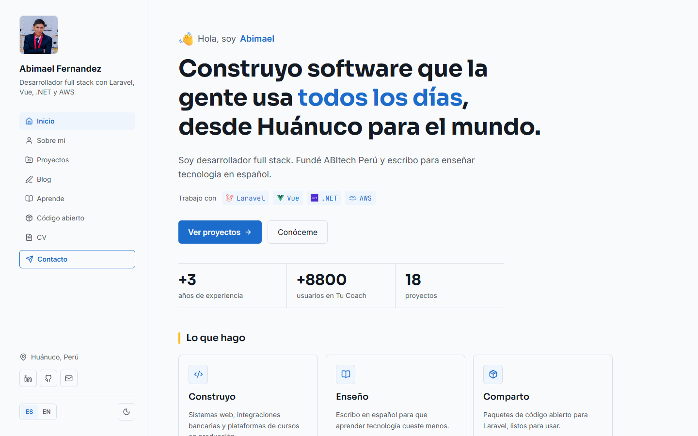
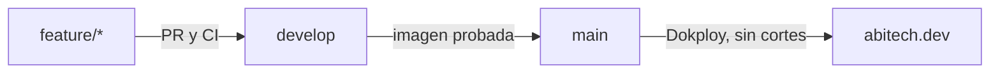

<div align="center">

# abitech.dev

Portafolio y blog de Abimael Fernandez, desarrollador full stack en
Huánuco, Perú.

[Visitar el sitio](https://abitech.dev) &nbsp;|&nbsp;
[Leer el blog](https://abitech.dev/blog) &nbsp;|&nbsp;
[English version](https://abitech.dev/en)

[](https://github.com/abitech-dev/abitech-portafolio-web/actions/workflows/ci.yml)


</div>

<picture>
  <source media="(prefers-color-scheme: dark)" srcset="docs/capturas/inicio-oscuro.png">
  
</picture>

## Qué hay en el sitio

| Sección        | Contenido                                                    |
| -------------- | ------------------------------------------------------------ |
| Proyectos      | Sistemas en producción con capturas, tecnologías y enlaces   |
| Blog           | Artículos y notas en español e inglés, con etiquetas y RSS   |
| Aprende        | Libros para aprender tecnología en español                   |
| Código abierto | Paquetes para Laravel                                        |
| CV             | Trayectoria completa, con descarga en PDF en los dos idiomas |

## Cómo está hecho

- **Estático.** Astro genera HTML y solo carga Vue donde hay
  interacción.
- **Bilingüe.** Cada página existe en español y en inglés, enlazadas con
  `hreflang`.
- **Accesible.** Cada cambio pasa por Playwright con axe contra WCAG 2.2
  AA, en celular y en escritorio.
- **Seguro.** CSP con el hash de cada script en línea, HSTS y ningún
  script de terceros, salvo una analítica opcional sin cookies.
- **Claro y oscuro.** Sigue la preferencia del sistema y recuerda la
  elección de cada visitante.

La historia completa está en el artículo
[Cómo construí mi sitio](https://abitech.dev/blog/como-construi-mi-sitio).

## Tecnologías

| Capa           | Herramientas                                    |
| -------------- | ----------------------------------------------- |
| Sitio          | Astro 7, Vue 3.5, Tailwind CSS 4 y TypeScript 6 |
| Contenido      | Markdown y YAML en colecciones de Astro         |
| Pruebas        | Vitest, Playwright, axe y Lighthouse CI         |
| Servidor       | Caddy en Docker, desplegado con Dokploy         |
| Automatización | GitHub Actions, Dependabot y Lefthook           |

## Empezar

Necesitas Node 26. Con [fnm](https://github.com/Schniz/fnm), `fnm use`
toma la versión de `.node-version`.

```bash
git clone https://github.com/abitech-dev/abitech-portafolio-web.git
cd abitech-portafolio-web
fnm use
npm ci
npm run dev
```

El sitio queda en `http://localhost:4321`. Los datos del CV y de los
proyectos ya vienen en `src/data`.

| Comando              | Qué hace                                                |
| -------------------- | ------------------------------------------------------- |
| `npm run dev`        | Levanta el servidor de desarrollo                       |
| `npm run build`      | Compila el sitio en `dist/`                             |
| `npm run verificar`  | Revisa formato, estilo y tipos, prueba y compila        |
| `npm run e2e`        | Prueba en el navegador, con revisión de accesibilidad   |
| `npm run lighthouse` | Mide rendimiento, accesibilidad, buenas prácticas y SEO |
| `npm run capturas`   | Actualiza la captura de cada proyecto en línea          |
| `npm run datos`      | Copia el CV desde el repositorio privado del autor      |

## Estructura

```text
src/
├── components/   piezas de la interfaz
├── content/      blog, libros y paquetes en Markdown y YAML
├── data/         CV y proyectos en resume.json
├── i18n/         textos y rutas en español e inglés
├── layouts/      plantilla común de las páginas
├── lib/          lógica sin interfaz, con sus pruebas
└── pages/        rutas del sitio
tests/            pruebas unitarias y de navegador
docs/             guías y decisiones de arquitectura
```

## Del cambio a producción



Cada cambio entra por PR a `develop` y pasa seguridad, análisis
estático, pruebas unitarias, Playwright y Lighthouse. `develop` publica
una imagen de Docker, y `main` despliega esa misma imagen sin volver a
construirla. El detalle está en la [documentación](docs/).

## Contacto

Escríbeme desde [abitech.dev/contacto](https://abitech.dev/contacto) o
por [LinkedIn](https://www.linkedin.com/in/abitechdev/).

## Licencia

El código tiene [licencia MIT](LICENSE). Puedes usarlo como base para tu
propio sitio.

El contenido no entra en esa licencia y conserva todos sus derechos.
Esto incluye los textos del blog y de Aprende en `src/content`, los datos
del CV en `src/data`, las fotos en `src/assets` y los PDF en
`public/descargas`. Si reutilizas el código, cambia esos archivos por los
tuyos.

Los logos pertenecen a cada proyecto. El emoji de saludo es de
[Fluent Emoji](https://github.com/microsoft/fluentui-emoji) de Microsoft,
con licencia MIT ([texto](licencias/fluent-emoji.txt)).
