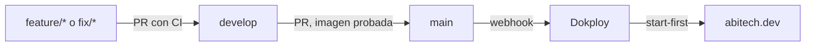

# Desplegar el sitio

Cómo llega un cambio a abitech.dev y cómo se prepara el servidor. La
decisión detrás está en el
[ADR 0002](../decisiones/0002-ramas-y-despliegue.md).

## Flujo de un cambio



1. Crea la rama desde `develop`.

   ```bash
   git switch develop && git pull
   git switch -c feature/nombre-del-cambio
   ```

2. Abre el PR a `develop`. La CI corre seguridad, análisis estático,
   pruebas unitarias, Playwright y Lighthouse.
3. Une el PR. `develop` construye la imagen, la prueba y la publica en
   GHCR con la etiqueta `arbol-<huella>`.
4. Abre el PR de `develop` a `main`. Solo comprueba que esa imagen exista.
5. Une el PR. **Desplegar a prod** marca la imagen como
   `prod`, avisa a Dokploy y espera a que el sitio muestre la versión
   nueva.

Un arreglo urgente sale de `main` como `hotfix/nombre`, vuelve a `main`
por PR y después se une a `develop`.

Las ramas `develop` y `main` solo aceptan cambios por PR y con la CI en
verde.

## Arquitectura

```text
Visitante ─HTTPS─▶ CloudPanel (nginx, TLS) ─▶ 127.0.0.1:8085 ─▶ Swarm ─▶ Caddy
```

| Pieza      | Responsabilidad                                          |
| ---------- | -------------------------------------------------------- |
| CloudPanel | Dominio, certificado y proxy inverso                     |
| Dokploy    | Descarga la imagen y la corre como servicio de Swarm     |
| Caddy      | Sirve `dist/` con CSP, HSTS y caché, dentro de la imagen |
| GHCR       | Guarda las imágenes. El paquete es público               |

## Preparar el servidor

Se hace una sola vez. Cada paso indica dónde se configura.

### 1. Dokploy

Crea una aplicación de tipo **Application** y configúrala así.

| Pestaña y sección           | Campo           | Valor                                                 |
| --------------------------- | --------------- | ----------------------------------------------------- |
| General → Provider          | Docker Image    | `ghcr.io/abitech-dev/abitech-portafolio-web:prod`     |
| General → Provider          | Registry URL    | `ghcr.io`, sin usuario ni contraseña                  |
| General                     | Autodeploy      | Encendido                                             |
| Advanced → Ports            | Puerto          | `8085` publicado, `80` destino, TCP, modo **Ingress** |
| Advanced → Resources        | Memory Limit    | `134217728` (128 MB)                                  |
| Advanced → Resources        | CPU Limit       | `500000000` (medio CPU)                               |
| Advanced → Swarm → Network  | Network Name    | `abitechportafolio-red`                               |
| Advanced → Swarm → Update   | Ver tabla abajo |                                                       |
| Advanced → Swarm → Rollback | Ver tabla abajo |                                                       |

La red overlay se crea antes en el servidor.

```bash
docker network create --driver overlay abitechportafolio-red
```

Para desplegar sin cortes, Swarm levanta el contenedor nuevo, espera su
`HEALTHCHECK` y recién apaga el anterior.

| Campo                 | Update Config | Rollback Config |
| --------------------- | ------------- | --------------- |
| Parallelism           | `1`           | `1`             |
| Delay (nanoseconds)   | `10000000000` | `0`             |
| Failure Action        | `rollback`    | `pause`         |
| Monitor (nanoseconds) | `30000000000` | `30000000000`   |
| Max Failure Ratio     | `0`           | `0`             |
| Order                 | `start-first` | `start-first`   |

Health Check, Restart Policy y las demás secciones quedan vacías. No se
asigna dominio en Dokploy.

### 2. Cerrar el puerto al público

Docker publica sus puertos por encima del firewall de CloudPanel. El
script `/usr/local/sbin/cerrar-puertos-docker.sh` los bloquea en la cadena
`DOCKER-USER` para la interfaz pública, y el servicio
`cerrar-puertos-docker` lo aplica al arrancar Docker.

Un puerto nuevo se agrega a su lista y se aplica con
`systemctl restart cerrar-puertos-docker`. CloudPanel sigue llegando por
`127.0.0.1`.

### 3. CloudPanel

1. Crea un sitio **Reverse Proxy** para `abitech.dev` con la URL
   `http://127.0.0.1:8085`.
2. Emite el certificado de Let's Encrypt para `abitech.dev` y
   `www.abitech.dev`.
3. En la pestaña **Vhost**, dentro del segundo bloque `server`, haz dos
   cambios.

   | Cambio                                          | Motivo                                |
   | ----------------------------------------------- | ------------------------------------- |
   | Borrar `include /etc/nginx/global_settings;`    | Sus cabeceras pisan las de Caddy      |
   | Borrar `add_header Cache-Control no-transform;` | Duplica la cabecera de caché          |
   | Agregar `ssl_buffer_size 4k;`                   | Ahorra un viaje antes del primer byte |

### 4. GitHub

| Dónde                                        | Qué                                                      |
| -------------------------------------------- | -------------------------------------------------------- |
| Settings → Environments                      | Entorno `prod`, limitado a la rama `main`                |
| Ese entorno → Secrets                        | `DOKPLOY_WEBHOOK_URL`, la URL de Dokploy → Deployments   |
| Settings → Secrets and variables → Variables | `URL_DEL_SITIO` = `https://abitech.dev`, sin barra final |
| Settings → Rules                             | `develop` y `main` solo por PR y con la CI en verde      |

El secreto se guarda sin mostrarlo.

```powershell
$env:GH_TOKEN = gh auth token -u abitech-dev
gh secret set DOKPLOY_WEBHOOK_URL --env prod -R abitech-dev/abitech-portafolio-web
Remove-Item Env:GH_TOKEN
```

### 5. Red del VPS

El VPS está en Europa, a unos 200 ms de Perú. Estos ajustes acortan la
primera visita en todos los sitios del servidor.

| Ajuste                                 | Dónde                              |
| -------------------------------------- | ---------------------------------- |
| BBR y `tcp_slow_start_after_idle = 0`  | `/etc/sysctl.d/90-red-lejana.conf` |
| `initcwnd 32` en las rutas por defecto | Servicio `ventana-tcp`             |

## Comprobar

```bash
curl -s https://abitech.dev/version.txt
curl -sI https://abitech.dev | grep -iE "content-security|strict-transport"
```

`version.txt` muestra la huella del árbol de git desplegado. La nota de
seguridad se revisa en
[HTTP Observatory](https://developer.mozilla.org/en-US/observatory).

## Problemas conocidos

| Síntoma                                           | Causa                                      | Solución                                  |
| ------------------------------------------------- | ------------------------------------------ | ----------------------------------------- |
| Dokploy falla con `dokploy-network` y error 403   | La red es `bridge` y Swarm exige `overlay` | Usar la red overlay propia del paso 1     |
| El sitio responde por `IP:8085`                   | Docker salta el firewall de CloudPanel     | Agregar el puerto al script del paso 2    |
| `Referrer-Policy` o `X-Content-Type` duplicadas   | `global_settings` de CloudPanel            | Quitar el `include` del vhost (paso 3)    |
| El despliegue falla en «Esperar la versión nueva» | Dokploy no cambió de contenedor            | Revisar la pestaña Deployments de Dokploy |

## Analítica opcional

Con las variables de Actions `PUBLIC_UMAMI_SRC` y `PUBLIC_UMAMI_ID`, la
imagen carga Umami y la CSP agrega su dominio. Sin ellas no se carga
ningún script de medición.
